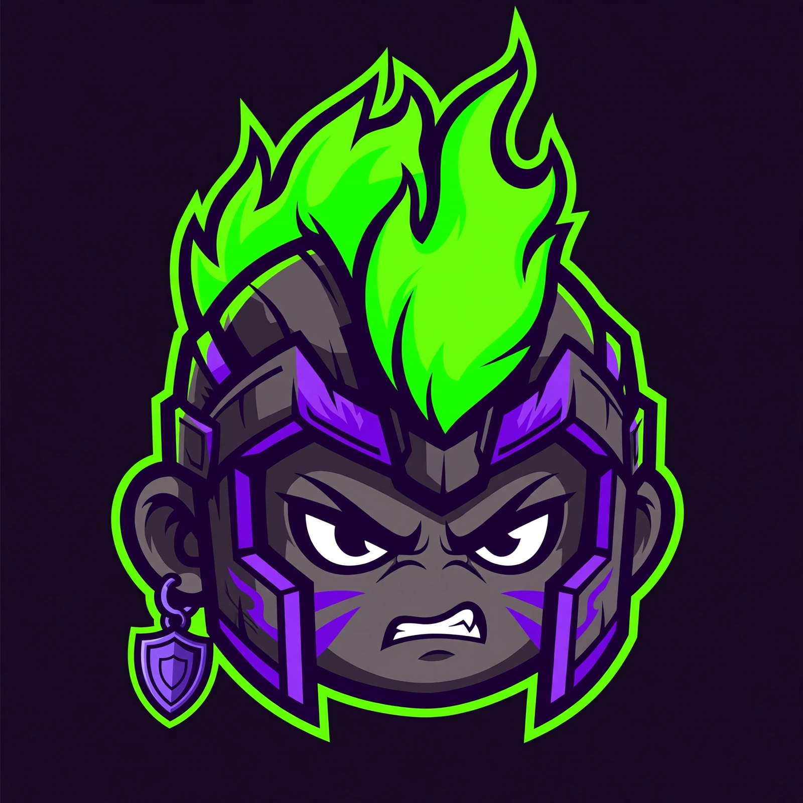

<p align="center">
  
</p>

<h1 align="center">STREAK — $STREAK</h1>

<p align="center"><strong>DON'T SELL. SURVIVE.</strong></p>

<p align="center">
  
  
  
  
</p>

---

STREAK is a Solana memecoin whose only product is a game engine. Every trade
pays a creator fee on pump.fun. That fee is the prize pool. An automated
engine — the **Survivor Engine** in this repository — claims the fees and,
every round, pays them out by fixed public rules: part is burned, part goes
to the holders who didn't move, and part feeds a jackpot that one survivor
eventually takes home.

No staking. No claiming. No wallet connection. Hold, don't move, survive.

> **Status: PRE-LAUNCH.** The token does not exist yet. The engine is built
> and running in public simulation (see `rounds/sample/` and
> `engine/sample-page.html`). The only real contract address will be the one
> announced through the official links below — anything else is an
> impersonator.

**Token CA:** TBA · **X:** TBA · **Site:** https://vault0-cell.github.io/streak/

---

## Contents

- [The rules](#the-rules)
- [One round, visually](#one-round-visually)
- [How to verify](#how-to-verify)
- [Why this can't quietly change](#why-this-cant-quietly-change)
- [FAQ](#faq)
- [Roadmap](#roadmap)
- [Repository map](#repository-map)
- [Links](#links)

---

## The rules

One **round** runs every **10 minutes**. The pot is the creator fees claimed
since the last round. The pot splits three ways, always:

| Slice | Share | What happens |
|---|---|---|
| Buyback & burn | **50%** | Buys $STREAK on the open market and sends it to the incinerator |
| Survivors | **30%** | Paid in SOL, directly to surviving wallets |
| Jackpot | **20%** | Added to the progressive jackpot pool |

**Survivor** — a wallet that, at round time:

- holds at least **$20 worth** of $STREAK, and
- has made **zero outbound movements** (no sells, no transfers out) in the
  trailing **48 hours**.

The 48h rule is a lookback, not a waiting period: a fresh buyer qualifies
from the very first round. It only bites after you move — sell once and you
sit out 48 hours.

**Streak** — the number of consecutive rounds you have survived. Any
outbound movement resets it to 0. So does dipping below the $20 line: if the
price falls, topping up to defend your streak is a legal — and intended —
move.

**Payouts** — the survivors' 30% is split by **√balance** (square root of
your bag). A bag 4× bigger earns 2× the share, not 4×, so small survivors
get a real slice. Shares below 0.0001 SOL are carried forward until they
clear the threshold, then paid in batches of up to 18 wallets per
transaction. If a round has no survivors, its 30% rolls into the jackpot —
never to the team.

**Buy boost** — buy at least **$5 worth** of $STREAK during a round and your
weight is multiplied by **×1.5** for that round (both the payout split and
the jackpot draw). Only real swap buys count; moving tokens between your
own wallets does not — and the sending wallet eats an outbound movement
anyway.

**Jackpot** — drawn every **144 rounds** (≈24h), or early once the pool
reaches **1 SOL**. Every survivor is entered with weight
**√balance × streak**: time in the game beats size of the bag. One winner
takes the whole pool. There is no team seed: the pool starts at zero at
launch and fills only from real fees, so the first draw pays out exactly
what trading put in.

A round pays only what trading actually brought in. Nothing is promised up
front, and quiet rounds pay little or nothing.

Full specification: [DESIGN.md](DESIGN.md).

---

## One round, visually

| When | What happens |
|---|---|
| T+0:00 | The round opens. Creator fees accrued since the last round are claimed — that SOL is the pot. |
| T+0:10 | Snapshot: every holder is read on-chain. Survivors are the wallets at $20+ with zero outbound movement in the trailing 48h; streaks update (+1 for survivors, reset to 0 for movers). |
| T+0:20 | The split runs by the fixed rules below — no discretion, no manual step. |
| T+0:30 | Payouts go out in batches of up to 18 wallets per transaction; the buyback-and-burn executes; if the draw is due, one survivor takes the jackpot. |
| T+1:00 | The round report (JSON + Markdown, with every payout signature) is committed to `rounds/` in this repository. |

```text
Buyback & burn   50%  ████████████████████
Survivors        30%  ████████████
Jackpot          20%  ████████
```

---

## How to verify

This repo is the transparency layer. Don't trust — recompute.

1. **Recompute a jackpot draw.** Every round report (`rounds/`) publishes
   the slot, the finalized blockhash, the full survivor weight list and a
   snapshot hash. The winner is
   `SHA-256(blockhash ‖ round)` mod total weight, walked across the
   published weights in order. Anyone can redo the math from the report
   alone and land on the same winner.
2. **Check any payout on-chain.** Round reports list every payout with its
   transaction signature. Open it in any Solana explorer and confirm the
   amounts and recipients match the report.
3. **Audit the rules themselves.** The rules in this repo *are* the
   engine's rules: the exact code that computes snapshots, streaks, splits
   and draws is in `engine/`, with unit tests in `engine/test/`. Parameter
   changes, if any ever happen, land here as commits — announced in advance,
   with the full history visible.
4. **Run the simulation yourself.**
   ```sh
   cd engine
   npm install
   node --test test/math.test.mjs   # math: splits, √ weights, dust, draws
   node test/make-fixture.mjs       # regenerate the 30-wallet fixture
   ```
   The fixture rounds it produces are the samples in `rounds/sample/`.

---

## Why this can't quietly change

- **The rules are the code.** The exact program that computes snapshots,
  streaks, splits and draws lives in `engine/`. If the engine's behavior
  ever diverged from the rules written here, the code would show it.
- **Parameter changes land as commits.** Any change to a number in these
  rules — the split, the $20 floor, the 48h window, the boost — has to
  arrive in this repository as a visible, timestamped diff, announced in
  advance. There is no admin panel and no silent switch.
- **Round reports are append-only history.** Every round's report is
  committed to `rounds/` and stays in git history forever. Rewriting a
  past round would rewrite public history — anyone holding a clone would
  see it.

---

## FAQ

**Do I need to connect my wallet or claim anything?**
No. If your wallet qualifies at a round, SOL is sent to it. There is
nothing to sign and no site to trust with your keys.

**Where does the SOL come from?**
Trading fees. Every $STREAK trade on pump.fun pays a creator fee; fee
sharing routes 100% of it to the engine wallet. A round pays out only
what trading actually brought in.

**Is anything promised?**
No. Nothing is promised up front, and quiet rounds pay little or nothing.
Payouts depend entirely on trading volume; when nobody trades, nobody
gets paid.

**What happens if I sell a little?**
Any outbound movement resets your streak to 0 and you sit out 48 hours.
SOL you already earned stays yours.

**Is this affiliated with pump.fun?**
No. STREAK is an independent token that trades on pump.fun; the engine
is run by the STREAK team.

---

## Roadmap

- [x] Survivor Engine designed, built, and unit-tested (17/17)
- [x] Buy Boost rule implemented and tested
- [x] Transparency repository public (this repo)
- [x] Landing page live on GitHub Pages
- [ ] Live executor (real claim / payout / burn execution) — in progress
- [ ] Engine wallet created and fee sharing configured at launch
- [ ] Token launch on pump.fun (pending the remaining user steps)
- [ ] First live rounds published to `rounds/`

---

## Repository map

| Path | Contents |
|---|---|
| `README.md` | This file |
| `DESIGN.md` | Full engine specification: rules, parameters, security model, go-live checklist |
| `engine/` | Survivor Engine source (Node), its README, unit tests, and fixture data — simulation build, contains no signing or broadcasting code |
| `rounds/` | After launch: every round report (JSON + Markdown), committed as rounds complete. `rounds/sample/` holds pre-launch fixture rounds |
| `site/` | The landing page source |
| `assets/` | Token image and brand assets |
| `SECURITY.md` | Engine-wallet security model and anti-impersonation notes |
| `LICENSE` | MIT |

## Links

- **Token (pump.fun):** TBA
- **Contract address:** TBA
- **X:** TBA
- **Site:** https://vault0-cell.github.io/streak/

---

STREAK is a memecoin with a game attached. It is not an investment product,
and holding it is not financial advice. Payouts depend entirely on trading
volume; when nobody trades, nobody gets paid.
